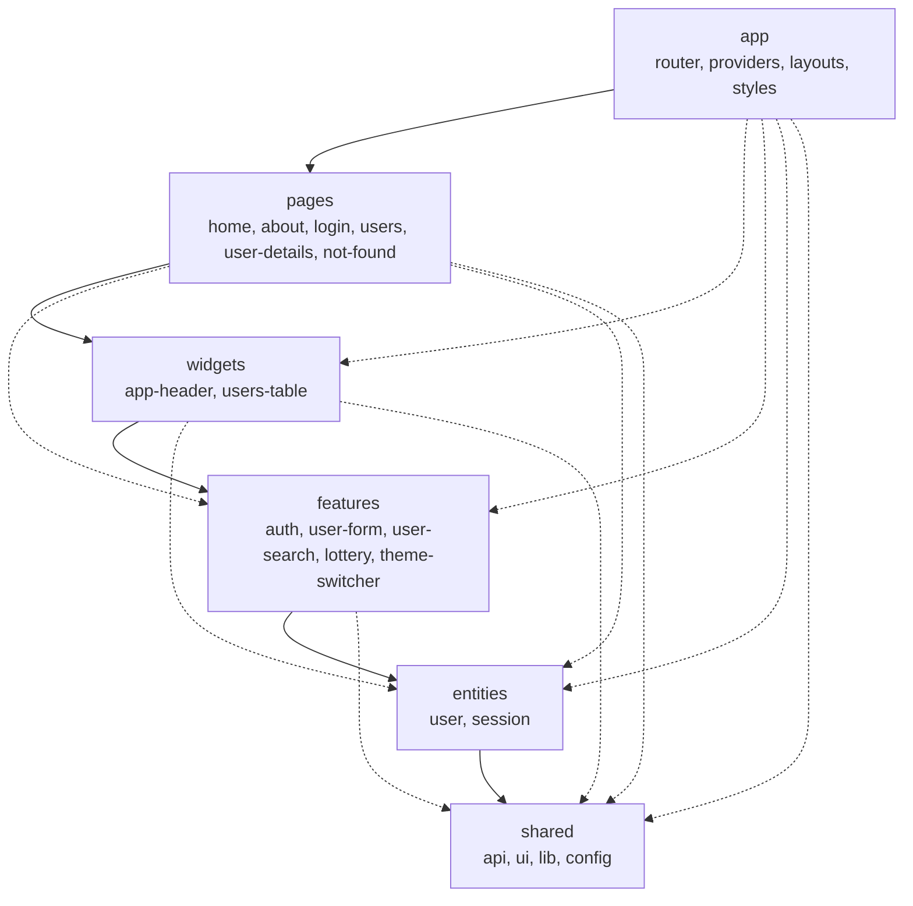

# vue-lottery-app

Лабораторна робота №6: архітектура Feature-Sliced Design (FSD), керування станом у Pinia, UI-бібліотека PrimeVue.
Функціонал лабораторної №5 (маршрутизація, користувачі, JWT-авторизація, Repository) збережено.

Vue 3 (Composition API) + TypeScript + Pinia + PrimeVue (Aura) + VeeValidate/Yup + SCSS + ESLint.

## Запуск

```bash
npm install
npm run dev          # dev-сервер
npm run lint         # ESLint (разом з правилами FSD)
npm run lint:fsd     # лише перевірка src/ (правила FSD: напрямок залежностей і Public API)
npm run type-check   # перевірка типів
npm run build        # збірка (створює і dist/404.html для gh-pages)
npm run deploy       # збірка + публікація dist у гілку gh-pages
```

Налаштування середовища лежать у `.env` (не комітиться), приклад у `.env.example`:

```
VITE_API_URL=https://dummyjson.com
```

Тестовий вхід: `emilys` / `emilyspass`.

## Git: гілка feature/fsd

```bash
git checkout feature/routing
git checkout -b feature/fsd
# ... робота кроками (див. історію комітів) ...
git push -u origin feature/fsd
npm run deploy      # публікація у gh-pages
```

## Структура (FSD)

```
src/
  app/                    # ініціалізація: main.ts, App.vue, layouts, styles
    providers/
      router/             #   routes.ts, guards.ts, index.ts, route-meta.d.ts
      services.ts         #   реєстрація UserService та AuthService у ServiceProvider
      ui.ts               #   підключення PrimeVue (тема, ToastService)
      auth.ts             #   зв'язок http-клієнта зі стором сесії
  pages/                  # home, about, login, users, user-details, not-found
  widgets/                # app-header (AppHeader, AppNavigation, AppLogo), users-table
  features/               # auth, user-form, user-search, lottery, theme-switcher
  entities/
    user/                 #   model (types, users.store), api (UserService), lib (fullName)
    session/              #   model (session.store, types), api (AuthService)
  shared/
    api/                  #   http-client, інтерфейси Repository, ServiceProvider (реєстр)
    ui/                   #   App* обгортки над PrimeVue
    lib/  config/
```

Кожен слайс відкриває назовні лише `index.ts` (Public API). Правила перевіряє `eslint-plugin-boundaries`
(`eslint.config.js`): імпорти «вгору», між слайсами одного шару та «вглиб» слайса є помилками.

## Діаграма залежностей шарів

Стрілка означає «може імпортувати». Слайси одного шару одне одного не імпортують.



## Repository у структурі FSD

| Частина | Розташування |
|---|---|
| HTTP-клієнт, інтерфейси `Readable`, `Creatable`, `Editable`, `Deletable` | `shared/api` |
| `User`, `CreateUserDto`, `UpdateUserDto` | `entities/user/model` |
| `UserService` | `entities/user/api` |
| `AuthService`, типи авторизації | `entities/session/api`, `entities/session/model` |
| `ServiceProvider` (універсальний реєстр) | `shared/api` |
| Реєстрація сервісів | `app/providers/services.ts` |

`shared` не може залежати від `entities`, тому `ServiceProvider` не знає про конкретні сервіси:
вони реєструються в `app` (`ServiceProvider.register('users', () => new UserService())`), а стори
отримують їх через `ServiceProvider.get<UserService>('users')`. Сторінки й віджети працюють лише зі сторами.

## Pinia

- `useSessionStore` (`entities/session`): `accessToken`, `refreshToken`, `user`, `isAuthenticated`,
  `setSession` / `clearSession`, `login`, `logout`, `fetchCurrentUser`, `refreshAccessToken`.
- `useUsersStore` (`entities/user`): `users`, `total`, `isLoading`, `error`, `fetchUsers`, `fetchUser`,
  `createUser`, `updateUser`, `removeUser`. DummyJSON імітує запис, тому стор сам веде локальний стан
  (створені, змінені й видалені користувачі).
- `useWinnersStore` (`features/lottery`), `useThemeStore` (`features/theme-switcher`).
- Усі стори — setup stores; у компонентах state та getters беруться через `storeToRefs`, actions деструктуруються напряму.

## UI-бібліотека (PrimeVue)

- Компоненти імпортуються окремо (`primevue/button`, `primevue/datatable`, ...), глобальної реєстрації немає (tree-shaking).
- Прямі імпорти `primevue/*` є лише в `shared/ui` та `app/providers/ui.ts`. Решта коду користується `AppButton`,
  `AppInput`, `AppSelect`, `AppTable`, `AppConfirmDialog`, `AppModal`, `AppPagination`, `AppMessage`, `AppToast` тощо.
- Тема: Aura з основним кольором `#3aafd9` (`definePreset` у `app/providers/ui.ts`).
- Темна тема вмикається класом `.app-dark` на `<html>` (`features/theme-switcher`), вибір зберігається в `localStorage`.
- Результат операцій (створено, оновлено, видалено, помилка входу) показується через toast (`useNotify`).

## Збереження стану Pinia: вручну чи плагіном

У проєкті є обидва підходи:

- `entities/session/model/session.store.ts` — ручна реалізація (`loadSession`, `persist` у `setSession` / `clearSession`).
- `features/theme-switcher/model/theme.store.ts` — `pinia-plugin-persistedstate` (`persist: { key, pick }`).

| | Вручну | pinia-plugin-persistedstate |
|---|---|---|
| Обсяг коду | десятки рядків (читання, запис, try/catch) | один параметр `persist` |
| Контроль | повний: перевірка формату, міграції, що саме писати | `pick` / `omit`, свій `storage`, хуки `beforeHydrate` / `afterHydrate` |
| Ризик помилок | легко забути викликати `persist()` в новій дії | зберігається автоматично при кожній зміні |
| Залежності | немає | додаткова бібліотека |

Для сесії ручний варіант обрано свідомо: токени треба валідувати при читанні й очищати за один виклик.
Те саме через плагін виглядало б так:

```ts
export const useSessionStore = defineStore('session', () => { /* state, getters, actions */ }, {
  persist: { key: 'vue-lottery-auth', pick: ['accessToken', 'refreshToken', 'user'] },
})
```

## Маршрути

| URL | Опис | Доступ |
|---|---|---|
| `/` | Home | всі |
| `/about` | About author | всі |
| `/login` | Login (AuthLayout) | лише гості, авторизованих редіректить на `/users` |
| `/users?page=2&q=john` | Список, пагінація та пошук в query | requiresAuth |
| `/users/:id` | Деталі (`props: true`) | requiresAuth |
| `/users/:id/edit` | Вкладений маршрут редагування | requiresAuth |
| `/:pathMatch(.*)*` | 404 | всі |

## Контрольні запитання

1. **FSD** — методологія організації фронтенд-коду: єдині правила, де лежить код і хто від кого може залежати. Вирішує проблему хаотичної структури, циклічних залежностей та складної навігації по проєкту.
2. **Шари** (згори вниз): `app`, `pages`, `widgets`, `features`, `entities`, `shared`. Чим вище шар, тим більше він знає про застосунок; чим нижче, тим він загальніший і стабільніший.
3. **Головне правило:** модуль імпортує лише з шарів, що лежать нижче. `features` не може імпортувати з `widgets`.
4. Якщо слайси одного шару залежать один від одного, їх не можна змінювати чи прибрати окремо. Спільний код виносять нижче (в `entities` або `shared`) або об'єднують слайси.
5. **Слайс** — розбиття шару за предметною областю (`entities/user`). **Сегмент** — розбиття слайса за призначенням: `ui`, `model`, `api`, `lib`, `config`.
6. **Public API** — файл `index.ts` слайса, що реекспортує дозволене. Інші слайси імпортують лише з нього, тому внутрішню структуру можна змінювати без наслідків.
7. **entities** — бізнес-сутності й дані (`user`, `session`: типи, сервіс, store). **features** — дії користувача (вхід, створення користувача, пошук, тема).
8. В `app` і `shared` немає предметних областей: вони складаються безпосередньо із сегментів (`app/providers`, `shared/ui`).
9. `ServiceProvider` імпортував `UserService` з `entities`, а `shared` не може залежати від вищих шарів. Його зроблено універсальним реєстром (`register` / `get`), а сервіси реєструються в `app/providers/services.ts`.
10. **Pinia** — офіційне сховище стану для Vue 3. Порівняно зі звичайним composable зі спільним `ref` вона дає devtools, єдину реєстрацію сторів, підтримку SSR і плагіни.
11. **Options stores** описуються об'єктом (`state`, `getters`, `actions`), **setup stores** — функцією з `ref`, `computed` і функціями. `storeToRefs` перетворює state і getters на `ref`-и для деструктуризації.
12. При прямій деструктуризації `const { users } = store` ми копіюємо поточне значення, і реактивність втрачається. `storeToRefs` зберігає зв'язок зі стором.
13. Компонент не повинен знати про джерело даних. Через стор логіка завантаження, помилок і локального стану зосереджена в одному місці, її легше тестувати й перевикористовувати.
14. Якщо розкидати компоненти бібліотеки по коду, її важко замінити. Обгортки в `shared/ui` залишають залежність в одному шарі, а решта коду користується `AppButton`, `AppInput` тощо.
15. **Tree-shaking** — видалення невикористаного коду зі збірки. Для цього компоненти імпортують окремо (`primevue/button`) або використовують auto-import, а не підключають усю бібліотеку.
16. **Переваги FSD для малого застосунку:** передбачувана структура, лінтер на залежності, зручне масштабування. **Недоліки:** багато файлів і `index.ts`, дрібні слайси здаються надлишковими, потрібен час на звикання.
